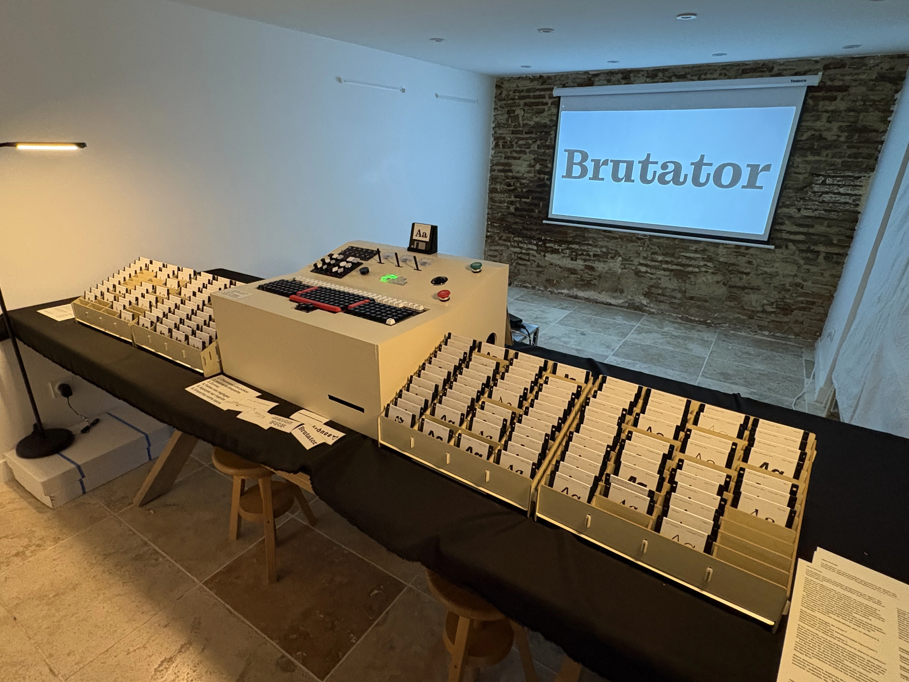

# The Brutator

**...is a physical type-tester machine, built for Bureau Brut's 10th anniversary, and presented at Code BEAM 26**



Bureau Brut is a french type foundry. Our idea was to give visitors a tangible experience : put a floppy disk in the machine to pick a font, type text, play with levers, switches and gauges, and leave with your own printed sticker.

Around 500 visitors used it over 4 days, and printed about 2000 stickers.

  

A few trivia :

- Everything was hand-built, the keyboard, the backlit keypad, the two switchboards (30 switches, 60 lamps) were designed, printed, soldered and wired by hand.
- Before any part was built, the whole console ran as an interactive drawing in a browser.
- The electronics are meaningless, all meaning and wiring between controls and state is done in-app.
- All outputs sync the app state and aren't tracked in firmware
- All events and outputs can be interchangeably physical, digital, or come from/go to any transport really
- The project was thought to be both fun to use and to create


  

## Slides

- English, technical audience: [slides (PDF)](Talk_English_Slides.pdf)
- Français, audience non technique : [slides (PDF)](Talk_French_slides.pdf)

## For developers

The Elixir application is in [`source/`](source), the board firmwares in [`source/physical_modules/`](source/physical_modules). To run the machine's digital twin yourself, with a copy of the real layout:

```
cd source
mix deps.get
mix bbparty.layout.import definitive_layout.json --mode replace_all
iex -S mix phx.server
```

<details>
<summary>Stage notes for myself</summary>

```
source .env (for the last demo)
iex -S mix phx.server
mix bbparty.display (don't forget it with stress)
```

</details>
