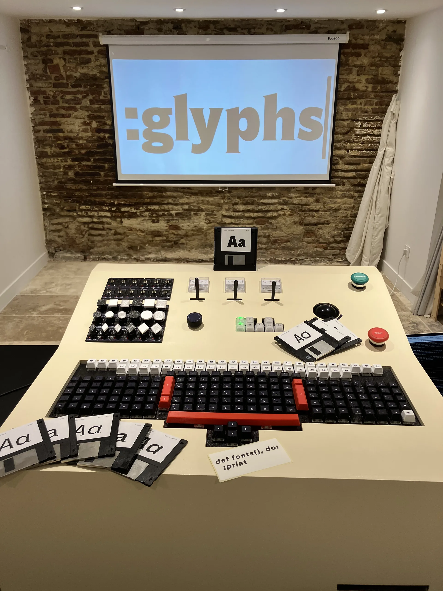
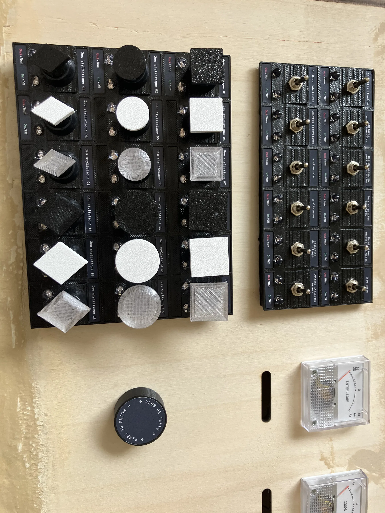
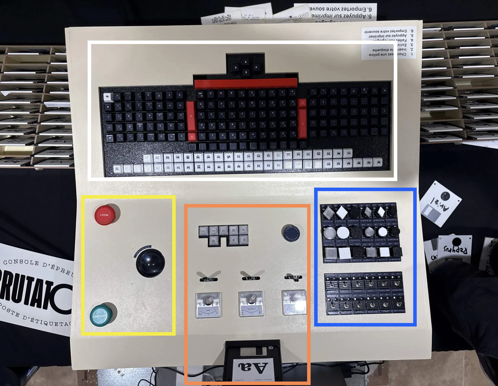
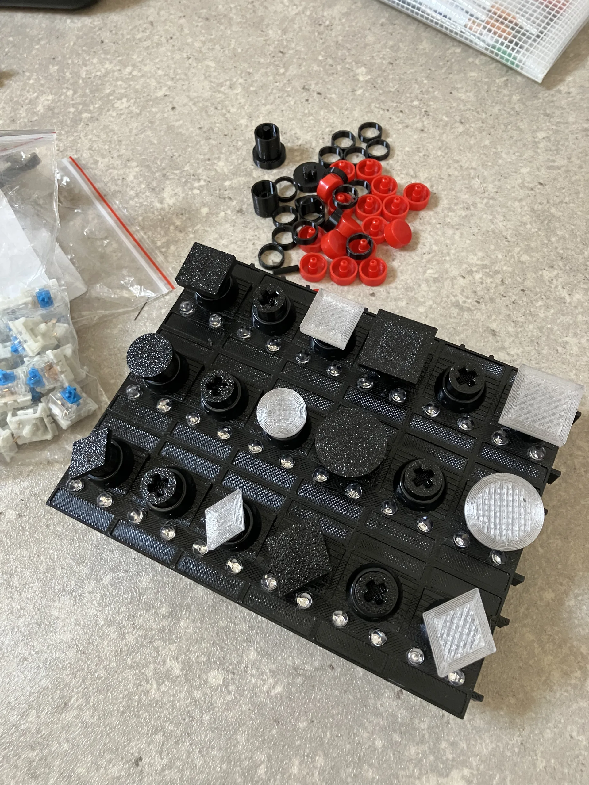

# The Brutator

**A physical type-testing machine, built for Bureau Brut's 10th anniversary, and presented at Code BEAM 26:
"From Pure Code to Physical Controls: Designing Hardware in Elixir".**


Bureau Brut is a type foundry: they design and sell fonts. Designers usually try fonts on a website before buying them. For their 10 years, the idea was to do it with something tangible and joyful instead: slip a floppy disk in the machine to pick a font, type a text, play with levers, switches and needles, and leave with your own printed sticker.

Around 500 visitors used it over 4 days, and printed about 2000 stickers.

<p>
  
  
</p>

## What to remember from the talks

- **Made, not bought.** The keyboard, the backlit keypad and the two switchboards (30 switches, 60 lamps) were designed, printed, soldered and wired by hand. The floppy reader is a fake: each disk hides an NFC tag naming its font.
- **The machine existed on screen first.** Before any part was built, the whole console ran as an interactive drawing in a browser. That "simulator" was never thrown away: it is the very program that ran in the exhibition, with the real buttons plugged in underneath.
- **The electronics are deliberately simple.** A button only says "I was pressed", a lamp only says "turn me on". What a button *means* lives in one place, a table describing the installation, so changing a control's role is a configuration change, not a rewiring.
- **Lamps show the state, not the gesture.** Indicator lamps always mirror what the machine is currently doing. If a board restarts mid-exhibition, it simply catches up with the present; nothing is replayed.
- **Anything can press the buttons.** Since the program doesn't care where a press comes from, the on-screen twin, a test script, or even an email can drive the real machine. On stage, sending a mail titled "Centré" centred the text.
- **Joy as a design goal.** In the spirit of William Morris, part of Bureau Brut's heritage: craft should be "a happiness to the maker and to the user".

<p>
  
  
</p>

## Slides

- English, technical audience: [slides (PDF)](Talk_English_Slides.pdf)
- Français, audience non technique : [slides (PDF)](Talk_French_slides.pdf)

## For developers

The Elixir application is in [`source/`](source), the board firmwares in [`source/physical_modules/`](source/physical_modules). To run the machine's digital twin yourself, with a copy of the real layout:

```
cd source
mix deps.get
mix bbparty.layout.import definitive_layout.json --mode replace_all
iex -S mix phx.server
```

<details>
<summary>Stage notes for myself</summary>

```
source .env (for the last demo)
iex -S mix phx.server
mix bbparty.display (don't forget it with stress)
```

</details>
